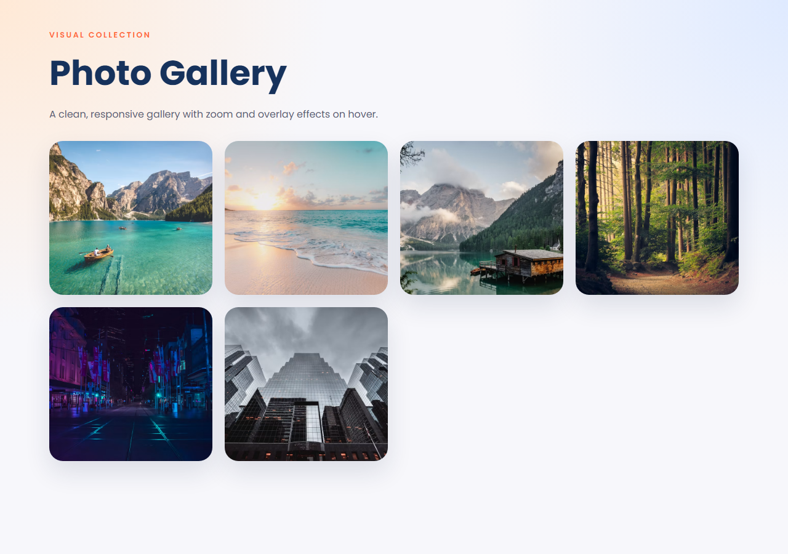
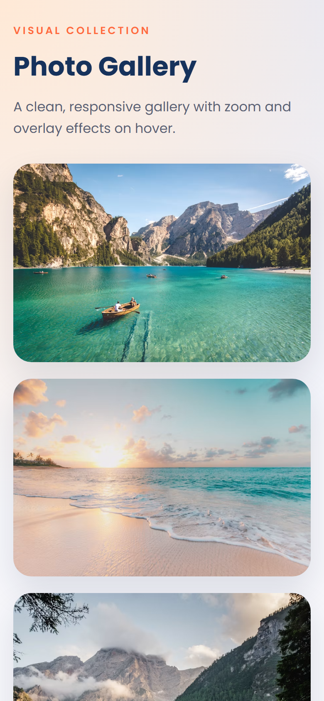

# Assignment 08

**Category:** Interactive UI Components

## Aim / Problem Statement
Create a Photo Gallery with at least six images and apply hover effects such as zoom or overlay.

## Technologies Used
- HTML5
- CSS3
- Responsive design (media queries)
- CSS Grid
- Flexbox
- Google Fonts

## Source Code
- `photogallery.html`
- `style.css`

## How to Run
Open `source-code/photogallery.html` in any modern browser (double-click the file), or serve the folder:

```bash
cd source-code
python -m http.server 8000
# then open http://localhost:8000/photogallery.html
```

## Steps Performed
1. Designed the page structure in HTML.
2. Styled the layout with CSS.
3. Built the layout using HTML and CSS only.
4. Ran the program in the browser and captured the output on desktop and mobile widths.

## Output
| Desktop | Mobile |
|---|---|
|  |  |
