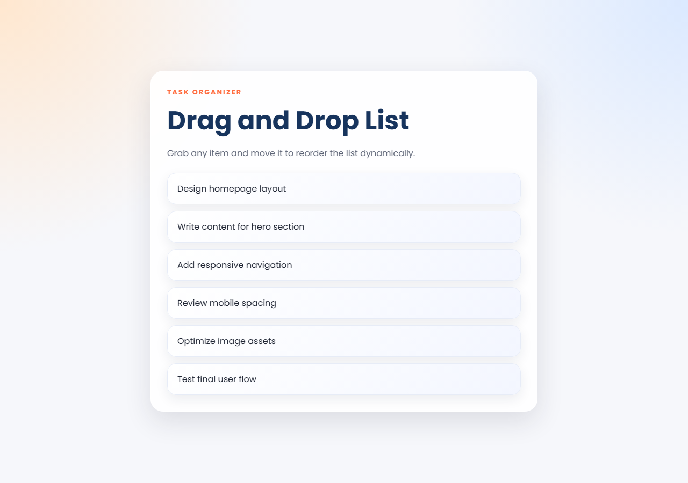
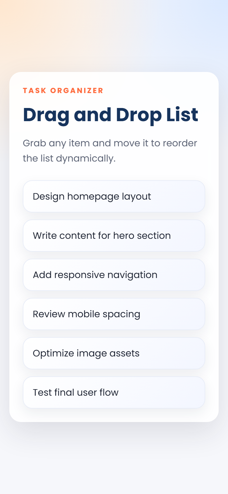

# Assignment 09

**Category:** Interactive UI Components

## Aim / Problem Statement
Implement a Drag-and-Drop List that allows users to reorder items dynamically.

## Technologies Used
- HTML5
- CSS3
- JavaScript (ES6)
- HTML Drag and Drop API
- Responsive design (media queries)
- Google Fonts

## Source Code
- `drag.html`
- `script.js`
- `style.css`

## How to Run
Open `source-code/drag.html` in any modern browser (double-click the file), or serve the folder:

```bash
cd source-code
python -m http.server 8000
# then open http://localhost:8000/drag.html
```

## Steps Performed
1. Designed the page structure in HTML.
2. Styled the layout with CSS.
3. Added the interactive behaviour in `script.js`.
4. Ran the program in the browser and captured the output on desktop and mobile widths.

## Output
| Desktop | Mobile |
|---|---|
|  |  |
