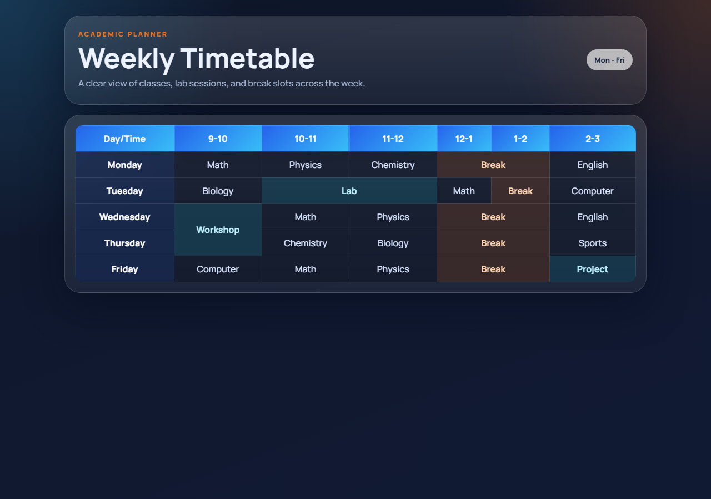
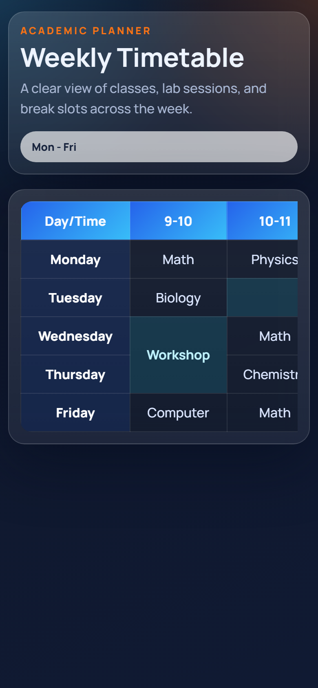

# Assignment 21

**Category:** HTML + CSS Design

## Aim / Problem Statement
Develop a Weekly Timetable using HTML tables with appropriate use of rowspan and colspan.

## Technologies Used
- HTML5
- CSS3
- Responsive design (media queries)
- Flexbox
- Google Fonts

## Source Code
- `style.css`
- `timetable.html`

## How to Run
Open `source-code/timetable.html` in any modern browser (double-click the file), or serve the folder:

```bash
cd source-code
python -m http.server 8000
# then open http://localhost:8000/timetable.html
```

## Steps Performed
1. Designed the page structure in HTML.
2. Styled the layout with CSS.
3. Built the layout using HTML and CSS only.
4. Ran the program in the browser and captured the output on desktop and mobile widths.

## Output
| Desktop | Mobile |
|---|---|
|  |  |
