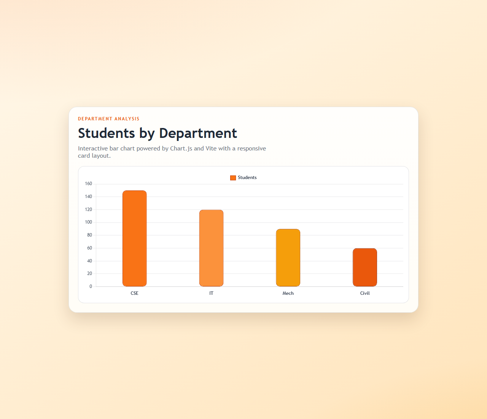
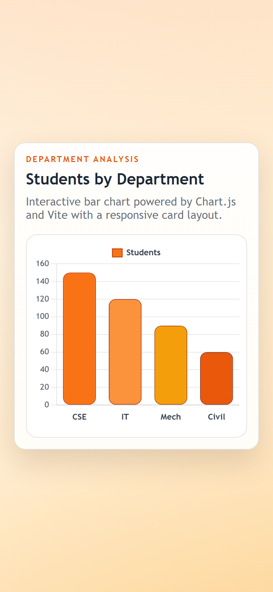

# Assignment 25

**Category:** Data Visualization / Charts

## Aim / Problem Statement
Create a Bar Chart to visualize the number of students in different departments using static data.

## Technologies Used
- HTML5
- CSS3
- JavaScript (ES6)
- Chart.js
- Vite
- Responsive design (media queries)

## Source Code
- `index.html`
- `main.js`
- `package.json`
- `style.css`

## How to Run
This chart app uses **Chart.js** and is bundled with **Vite**:

```bash
cd source-code
npm install
npm run dev        # development server
npm run build      # production build in dist/
```

## Steps Performed
1. Designed the page structure in HTML.
2. Styled the layout with CSS.
3. Implemented the chart logic in `main.js` using Chart.js.
4. Ran the program in the browser and captured the output on desktop and mobile widths.

## Output
| Desktop | Mobile |
|---|---|
|  |  |
